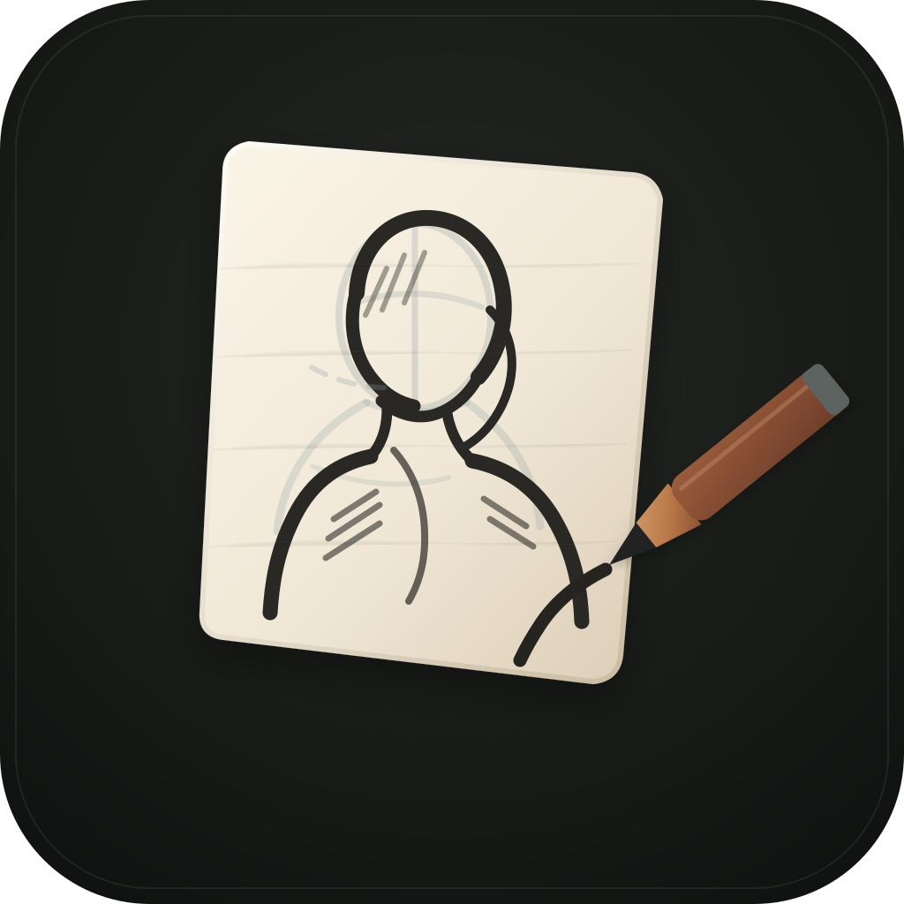
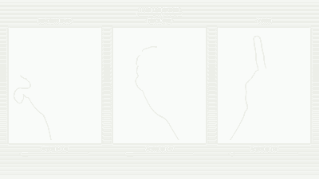
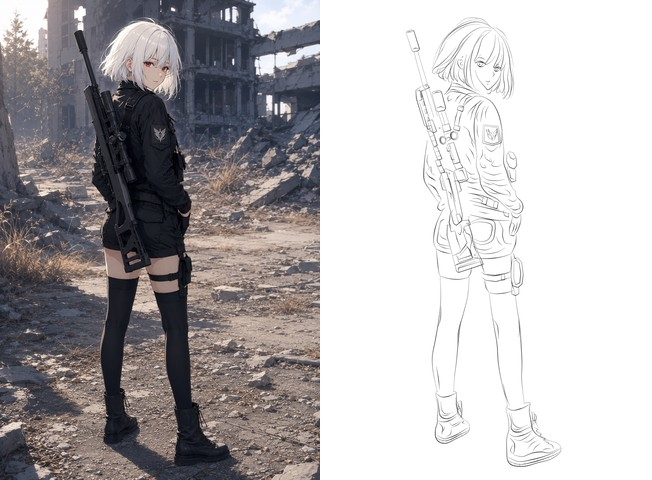

<div align="center">
  
  <h1>img2drawing</h1>
  <p><strong>From observation to explicit, editable pencil and ink marks.</strong></p>
  <p>
    <a href="https://github.com/ictseoyoungmin/img2drawing/releases/latest"></a>
    <a href="https://github.com/ictseoyoungmin/img2drawing/actions/workflows/ci.yml"></a>
    
    <a href="LICENSE"></a>
  </p>
</div>

**Current stable: v1.5.0** · [Releases](https://github.com/ictseoyoungmin/img2drawing/releases) · [Changelog](CHANGELOG.md)

An Agent Skill and Python drawing runtime for Claude Code, Codex, and other skill-capable agents.
Rather than requesting a finished image from an image generator, the agent observes a subject,
authors explicit strokes, inspects its drawing, and corrects visible problems.

**Drawing and optional editing**

- Pencil, G-pen, fineliner, wet ink, authored black/white areas and editable dot screentone.
- One action history, canonical PNG/replay and eligible fast GIF export.
- Optional layer controls: names, visibility, inherited locks, opacity, order and isolated groups.
- Shared graphite/ink/area/tone transforms; transparent PNG and OpenRaster with native checkpoints.

Pencil remains the default; enable layers and mixed tools when the task needs them. Normal is the
initial blend mode. Raster edits stay separate from native strokes; PSD and a visual editor are
future work. Existing material contracts remain unchanged in verified environments.
The [release notes](docs/releases/v1.5.0.md) record the measured drawing, replay and Krita
workflow, including raster recomposition and opacity limits. The actual release and its
assets establish publication.

## Drawing in action

<p align="center">
  
</p>

[](showcase/entries/croquis-sniper-girl-astra-v1/README.md)

[Full drawing timelapse](showcase/entries/croquis-sniper-girl-astra-v1/timelapse.gif) · [Showcase](showcase/README.md)

Curated stroke-authoring examples, not a guarantee of quality across all subjects or agents.

## What it does

- **Observation and construction:** establish proportions, orientation, silhouette, and form from
  a reference or declared imaginative goals.
- **Pencil authoring:** create explicit lines, curves, and tonal strokes with controllable pressure,
  width, grade, and opacity. Tonal plans guide marks without automatic fills.
- **Ink and tone authoring:** use an opt-in mixed profile for explicit paths, closed contours,
  white paint and analytic dot tones; no tracing or automatic region selection.
- **Inspection and correction:** compare the drawing with its reference, locate and revise marks,
  and retire unnecessary construction marks.
- **Persistent history:** retain drawing actions and the render profile for inspection, resumption,
  and replay.
- **Output:** PNG, end-to-end GIF, and optional editable-layer PNG/OpenRaster with native data.

**Croquis economizes marks, not observed geometry.** The agent makes artistic decisions;
the runtime supplies authoring, editing, and evidence tools.

## Install

Python 3.10+ is required. FFmpeg is optional for fast timelapse export.

### Agent Skill

Choose your agent:

```bash
npx skills add ictseoyoungmin/img2drawing --skill img2drawing --agent claude-code
npx skills add ictseoyoungmin/img2drawing --skill img2drawing --agent codex
```

For manual installation, copy only [skills/img2drawing/](skills/img2drawing/) into your agent's
skills directory. Developer test data and historical drawing runs are not needed.

### Python runtime

From a source checkout:

```bash
python -m pip install skills/img2drawing/
```

Packaged Python releases are available on [GitHub Releases](https://github.com/ictseoyoungmin/img2drawing/releases/latest).
On Windows, prefer a short extraction path.

## Quickstart

Give your agent a reference and a drawing goal:

> Read the img2drawing skill. Draw the attached reference with explicit pencil strokes.
> Establish the pose and major forms first, inspect and correct the drawing, and export
> the final PNG and full drawing timelapse. Do not use image generation or tracing.

For programmatic use:

```python
from img2drawing import DrawingIntent, DrawingSession

intent = DrawingIntent(drawing_mode="croquis", finish_intent="subject")
session = DrawingSession.create(
    subject="subject.png", output_dir="out", intent=intent
)

# Observe the reference and author strokes through the session.
# After authoring and inspection:
# session.render_final("out/final.png")
# session.export_timelapse("out/timelapse", every_n=4)
```

Start with [SKILL.md](skills/img2drawing/SKILL.md).
The [public API](skills/img2drawing/references/api/public-surface.md) documents runtime usage;
the [layer/exchange API](skills/img2drawing/references/api/layers-and-exchange.md) covers optional editing;
the [instruction graph](skills/img2drawing/references/INDEX.md) routes drawing knowledge.

## Project structure

```text
skills/img2drawing/    Deployable skill, runtime, drawing guidance
showcase/             Curated results
docs/releases/        Detailed release notes
dev/                  Tests, benchmarks, development tooling
CHANGELOG.md          Version history
```

The skill is self-contained. Development artifacts are kept separate.

## Development

- [Release notes](docs/releases/) · [Development status](dev/planning/vnext/STATUS.md) · [Roadmap](dev/planning/vnext/ROADMAP.md)

Contributions are welcome. Keep private references and generated run outputs outside the repository; prefer small, reproducible tests.

## License

[Apache License 2.0](LICENSE).
